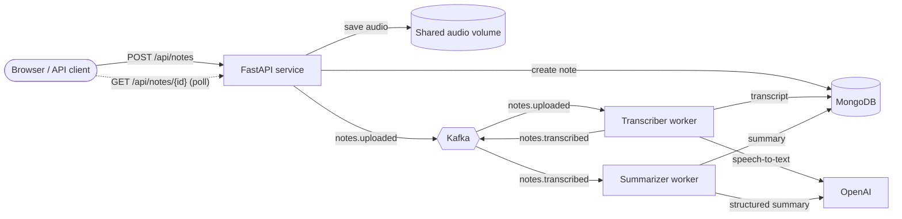

<div align="center">

# 🎙️ AI Note Taker

**Turn recordings into clear, structured notes: transcript, summary, key points and action items.**

[](https://github.com/Sepiboyboy/AI_Note_Taker/actions/workflows/ci.yml)


[](LICENSE)


</div>

## Overview

AI Note Taker is an event-driven service that takes an audio recording (a meeting, lecture or voice memo) and turns it into a note you can actually use. You upload a file or record in the browser. The audio goes through a pipeline of independent workers connected by Apache Kafka, and you get back:

- a full **transcript** (OpenAI speech-to-text),
- a **title** and short **overview**,
- the **key points**, and
- concrete **action items**.

The summary is produced with structured outputs, so it always matches a typed schema and is never free-form text that has to be parsed.

## Features

- **Upload or record:** drag and drop a file, or record from your microphone in the web UI.
- **Asynchronous pipeline:** uploads return immediately (`202 Accepted`), and transcription and summarization run in separate, independently scalable workers.
- **Reliable processing:** at-least-once delivery with manual offset commits. Atomic state transitions in MongoDB make every stage idempotent and safe to retry.
- **Clear lifecycle:** each note moves through `uploaded → transcribing → transcribed → summarizing → completed`, or ends as `failed` with a readable error.
- **Offline demo mode:** `AI_PROVIDER=mock` runs the whole system without an API key.
- **Production details:** input validation (type, size, empty files), streaming uploads, a non-root container, health checks, typed settings, tests and CI.

## Architecture



| Component | Responsibility |
|---|---|
| **API** (`notetaker.api`) | Validates and stores uploads, creates the note record, publishes `notes.uploaded`, and serves the REST API and web UI. |
| **Transcriber** (`notetaker-worker transcriber`) | Consumes `notes.uploaded`, transcribes the audio, stores the transcript, and publishes `notes.transcribed`. |
| **Summarizer** (`notetaker-worker summarizer`) | Consumes `notes.transcribed` and generates a structured `Summary` (title, overview, key points, action items). |
| **Kafka** | Decouples the stages. Events are keyed by note ID, so all events for one note are processed in order. |
| **MongoDB** | Source of truth for notes and their status. |

### Delivery guarantees

Kafka events carry only the note ID. Workers always re-read the current state from MongoDB, and each stage begins with an atomic compare-and-set (for example, `uploaded → transcribing`). As a result:

- **Duplicate events are harmless.** A note that has already moved past a stage is skipped.
- **Crashes are recoverable.** Offsets are committed only after a stage finishes. If a worker dies mid-task, the event is redelivered and the stage resumes.
- **AI failures are surfaced, not lost.** Provider errors (after the OpenAI client's built-in retries) mark the note `failed` with the reason.

## Quick start

**Requirements:** Docker with Docker Compose v2.

```bash
git clone https://github.com/Sepiboyboy/AI_Note_Taker.git
cd AI_Note_Taker
cp .env.example .env        # then set OPENAI_API_KEY
docker compose up --build -d
```

Open **http://localhost:8000** for the web app, or **http://localhost:8000/docs** for interactive API docs.

### Try it without an API key

```bash
AI_PROVIDER=mock docker compose up --build -d
```

Mock mode returns a sample transcript and builds an extractive summary locally. Every other part of the pipeline (Kafka, workers, MongoDB, UI) runs for real.

## API

| Method | Endpoint | Description |
|---|---|---|
| `POST` | `/api/notes` | Upload audio (`multipart/form-data`, field `file`). Returns `202` with the new note. |
| `GET` | `/api/notes` | List recent notes, newest first (`?limit=1..100`, default 50). |
| `GET` | `/api/notes/{id}` | Get a note, including its status, transcript and summary. |
| `DELETE` | `/api/notes/{id}` | Delete a note and its audio file. |
| `GET` | `/healthz` | Liveness check. |

Supported formats: `flac`, `m4a`, `mp3`, `mp4`, `mpeg`, `mpga`, `oga`, `ogg`, `wav`, `webm` (up to 25 MB by default).

```bash
# Upload
curl -F "file=@meeting.m4a" http://localhost:8000/api/notes
# {"id":"8293952e...","status":"uploaded", ...}

# Poll until status is "completed"
curl http://localhost:8000/api/notes/8293952e...
```

<details>
<summary>Example completed note</summary>

```json
{
  "id": "8293952e787c4e4c9f5b7702f0f5a26a",
  "filename": "Weekly product sync.m4a",
  "size_bytes": 2000,
  "status": "completed",
  "transcript": "Weekly product sync for the mobile team. The mobile release is on track for Friday...",
  "summary": {
    "title": "Weekly product sync for the mobile team",
    "overview": "The mobile release is on track for Friday after QA signed off on the payment flow...",
    "key_points": [
      "The mobile release is on track for Friday after QA signed off on the payment flow.",
      "Onboarding completion went up twelve percent since we shortened the sign-up form."
    ],
    "action_items": [
      "Sara will investigate the notification delays before Wednesday."
    ]
  },
  "error": null,
  "created_at": "2026-10-25T21:28:11.770000Z",
  "updated_at": "2026-10-25T21:28:11.784000Z"
}
```
</details>

## Configuration

All settings come from environment variables or a `.env` file (see [`.env.example`](.env.example)).

| Variable | Default | Description |
|---|---|---|
| `AI_PROVIDER` | `openai` | `openai` or `mock` (offline). |
| `OPENAI_API_KEY` | none | Required when `AI_PROVIDER=openai`. |
| `TRANSCRIPTION_MODEL` | `gpt-4o-mini-transcribe` | Speech-to-text model. |
| `SUMMARY_MODEL` | `gpt-5-mini` | Model for structured summaries. |
| `MAX_UPLOAD_MB` | `25` | Maximum upload size. |
| `OPENAI_MAX_RETRIES` | `3` | Retries for transient OpenAI errors. |
| `CORS_ORIGINS` | `["*"]` | Allowed origins, as a JSON list. |
| `KAFKA_BOOTSTRAP_SERVERS` | `localhost:9092` | Set automatically by Docker Compose. |
| `MONGO_URL` | `mongodb://localhost:27017` | Set automatically by Docker Compose. |
| `STORAGE_DIR` | `./data/audio` | Where audio is stored. Must be shared by the API and the transcriber. |
| `LOG_LEVEL` | `INFO` | Python log level. |

## Development

```bash
make install   # virtualenv + dev dependencies (Python 3.12)
make test      # pytest
make lint      # ruff lint + format check
make demo      # full stack with the mock AI provider
make logs      # follow api / worker logs
```

To run the services outside Docker, start only the infrastructure (`docker compose up -d kafka kafka-init mongodb`), set `KAFKA_BOOTSTRAP_SERVERS` and `MONGO_URL` in `.env`, then run:

```bash
uvicorn notetaker.api.app:create_app --factory --reload
notetaker-worker transcriber
notetaker-worker summarizer
```

Note that the broker advertises itself as `kafka:9092`. When connecting from the host, add `127.0.0.1 kafka` to `/etc/hosts` or run the services inside Compose.

The tests use in-memory fakes for MongoDB and Kafka, so they need no running services.

### Project structure

```
src/notetaker/
├── api/
│   ├── app.py          # FastAPI app factory and lifespan
│   ├── routes.py       # REST endpoints and upload validation
│   └── static/         # Single-page web UI (no build step)
├── workers/__main__.py # `notetaker-worker {transcriber|summarizer}`
├── pipeline.py         # The two processing stages (transport-agnostic)
├── ai.py               # OpenAI and mock transcriber/summarizer providers
├── messaging.py        # Kafka producer and at-least-once consumer loop
├── repository.py       # MongoDB persistence with atomic state transitions
├── storage.py          # Streaming, size-limited audio storage
├── models.py           # Note, Summary, NoteStatus, events
└── config.py           # Typed settings (pydantic-settings)
tests/                  # API and pipeline tests
```

## Roadmap

- Speaker diarization and timestamps in transcripts
- Chunking for recordings longer than the provider's file limit
- Object storage (S3/MinIO) instead of a shared volume
- Authentication and per-user notes
- Server-sent events instead of polling for status updates

## License

[MIT](LICENSE) © Sepehr Kiaei
