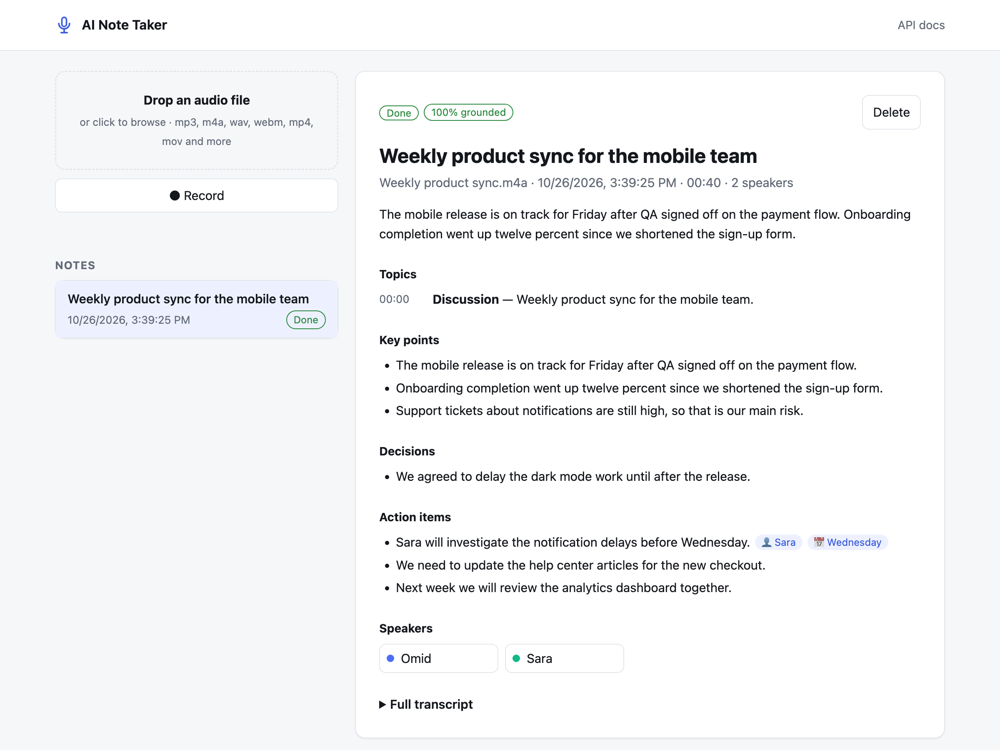
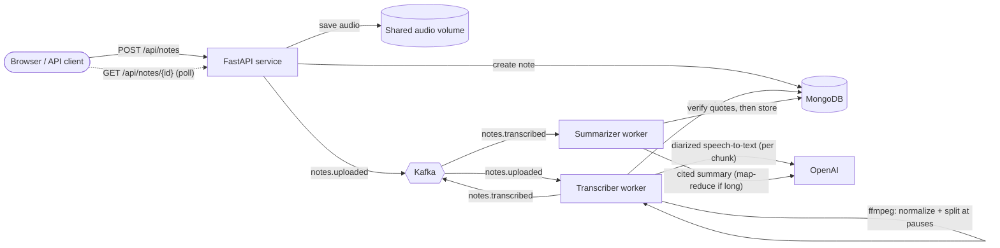

<div align="center">

# 🎙️ AI Note Taker

**Turn recordings into clear, structured notes, where every point and action item cites the transcript line it came from.**

[](https://github.com/Sepiboyboy/AI_Note_Taker/actions/workflows/ci.yml)


[](LICENSE)



</div>

## Overview

AI Note Taker is an event-driven service that takes an audio recording (a meeting, lecture or voice memo) and turns it into a note you can actually use. You upload a file or record in the browser. The audio goes through a pipeline of independent workers connected by Apache Kafka, and you get back:

- a **transcript** with **speaker labels** and **timestamps**,
- a **title**, a short **overview** and a timed **topic outline**,
- the **key points** and **decisions**, and
- **action items** with owner and due date.

Every key point, decision and action item cites the transcript segments it came from, together with a verbatim quote. A deterministic check then confirms that each quote really appears there. Items that fail the check are flagged rather than silently trusted (see [Trustworthy summaries](#trustworthy-summaries)).

## Features

- **Upload or record:** drag and drop a file, or record from your microphone in the web UI.
- **Who said what:** speaker-labelled transcripts (`gpt-4o-transcribe-diarize`), with timestamps and speakers you can rename.
- **Long recordings:** audio is re-encoded and split at pauses with ffmpeg, so a multi-hour meeting works even though OpenAI caps each request at 25 MB.
- **Grounded summaries:** each item links to its source lines (click it to jump to them). Unsupported items and unconfirmed owners are flagged, and every note gets a *grounding score*.
- **Asynchronous pipeline:** uploads return immediately (`202 Accepted`), and transcription and summarization run in separate, independently scalable workers.
- **Reliable processing:** at-least-once delivery with manual offset commits. Atomic state transitions in MongoDB make every stage idempotent and safe to retry.
- **Clear lifecycle:** each note moves through `uploaded → transcribing → transcribed → summarizing → completed`, or ends as `failed` with a readable error.
- **Offline demo mode:** `AI_PROVIDER=mock` runs the whole system without an API key.
- **Production details:** input validation (type, size, empty files), streaming uploads, a non-root container, health checks, typed settings, tests and CI.

## Architecture



| Component | Responsibility |
|---|---|
| **API** (`notetaker.api`) | Validates and stores uploads, creates the note record, publishes `notes.uploaded`, and serves the REST API and web UI. |
| **Transcriber** (`notetaker-worker transcriber`) | Consumes `notes.uploaded`, normalizes and chunks the audio, transcribes it with speaker labels, stores the segments, and publishes `notes.transcribed`. |
| **Summarizer** (`notetaker-worker summarizer`) | Consumes `notes.transcribed`, generates a cited summary, verifies every citation against the transcript, and stores the result. |
| **Kafka** | Decouples the stages. Events are keyed by note ID, so all events for one note are processed in order. |
| **MongoDB** | Source of truth for notes and their status. |

### Delivery guarantees

Kafka events carry only the note ID. Workers always re-read the current state from MongoDB, and each stage begins with an atomic compare-and-set (for example, `uploaded → transcribing`). As a result:

- **Duplicate events are harmless.** A note that has already moved past a stage is skipped.
- **Crashes are recoverable.** Offsets are committed only after a stage finishes. If a worker dies mid-task, the event is redelivered and the stage resumes.
- **AI failures are surfaced, not lost.** Provider errors (after the OpenAI client's built-in retries) mark the note `failed` with the reason.

## Transcription

1. **Normalize.** ffmpeg converts any input (mp3, m4a, wav, mov, ...) to mono 16 kHz 32 kbps mp3, about 14 MB per hour, which is plenty for speech.
2. **Split.** Recordings longer than `CHUNK_SECONDS` (10 minutes) are cut into near-equal chunks. Each boundary moves to the nearest pause, found with ffmpeg's `silencedetect`, so words are not cut in half.
3. **Keep speakers consistent.** A diarization model labels speakers independently in each request, so "A" in one chunk might be "B" in the next. The transcriber transcribes the first chunk, cuts a 2-10 s reference clip of each speaker, and passes those clips as `known_speaker_references` with every later chunk. Those chunks then run in parallel.
4. **Merge.** Segment timestamps are shifted by each chunk's offset and numbered globally.

> **Limitation:** OpenAI accepts at most 4 reference speakers. With more than 4 speakers, labels for the 5th and later may differ between chunks.

## Trustworthy summaries

Research on LLM meeting summaries highlights two failure modes. Long transcripts **lose details** ([Golia & Kalita, 2023](https://paperswithcode.com/paper/action-item-driven-summarization-of-long)). Models also **invent commitments**, such as assigning a task to someone who never agreed to it ([survey](https://arxiv.org/pdf/2212.08206); FRAME/SCOPE, EMNLP 2025 Findings). This project addresses both.

**Citations by construction.** The model sees the transcript as `[S12 03:14 Sara] ...` lines. Every key point, decision and action item it writes must include `segment_ids` and a verbatim `quote`. Owners and due dates may only be filled in when the transcript states them explicitly.

**Deterministic verification** (`grounding.py`, no extra model calls):
- A quote counts as found if it appears in the cited segments, ignoring case and punctuation, with a fuzzy match (≥ 0.9) for small transcription differences.
- If the model cited the wrong segments, the whole transcript is searched (including quotes spanning two segments), and the citation is corrected.
- An action item's **owner** is confirmed only if they are the speaker of a cited segment or are named in it. "Priya to begin vendor onboarding" is flagged when Priya never spoke or was never assigned it.
- The **grounding score** is the share of items whose quote was found. Unverified items are shown with a ⚠ badge. Set `DROP_UNVERIFIED_ITEMS=true` to remove them instead.

**Long meetings: map, then reduce.** Transcripts over `SUMMARY_SINGLE_PASS_TOKENS` are split into sections of about 8k tokens. Cuts fall at a speaker change or a pause. Each section is processed in parallel to extract its topics, points, decisions and action items. A final step merges duplicates and writes the overview. Segment IDs are global, so citations survive the merge and are still verified at the end.

## Quick start

**Requirements:** Docker with Docker Compose v2.

```bash
git clone https://github.com/Sepiboyboy/AI_Note_Taker.git
cd AI_Note_Taker
cp .env.example .env        # then set OPENAI_API_KEY
docker compose up --build -d
```

Open **http://localhost:8000** for the web app, or **http://localhost:8000/docs** for interactive API docs.

### Try it without an API key

```bash
AI_PROVIDER=mock docker compose up --build -d
```

Mock mode returns a sample transcript and builds an extractive summary locally. Every other part of the pipeline (Kafka, workers, MongoDB, UI) runs for real.

## API

| Method | Endpoint | Description |
|---|---|---|
| `POST` | `/api/notes` | Upload audio or video (`multipart/form-data`, field `file`). Returns `202` with the new note. |
| `GET` | `/api/notes` | List recent notes, newest first (`?limit=1..100`, default 50). |
| `GET` | `/api/notes/{id}` | Get a note, including its status, transcript and summary. |
| `PATCH` | `/api/notes/{id}/speakers` | Rename speakers, e.g. `{"A": "Sara"}`. An empty name resets the label. |
| `DELETE` | `/api/notes/{id}` | Delete a note and its audio file. |
| `GET` | `/healthz` | Liveness check. |

Supported formats: `aac`, `flac`, `m4a`, `mkv`, `mov`, `mp3`, `mp4`, `mpeg`, `mpga`, `oga`, `ogg`, `opus`, `wav`, `webm` (up to 200 MB and 3 hours by default).

```bash
# Upload
curl -F "file=@meeting.m4a" http://localhost:8000/api/notes
# {"id":"8293952e...","status":"uploaded", ...}

# Poll until status is "completed"
curl http://localhost:8000/api/notes/8293952e...
```

<details>
<summary>Example completed note</summary>

```json
{
  "id": "eb4c130fb6634be78986c77031dd3c8b",
  "filename": "Weekly product sync.m4a",
  "size_bytes": 2000,
  "status": "completed",
  "duration_seconds": 40.4,
  "transcript": "Weekly product sync for the mobile team. The mobile release is on trac...",
  "segments": [
    {
      "id": 0,
      "speaker": "A",
      "start": 0.0,
      "end": 2.8,
      "text": "Weekly product sync for the mobile team."
    },
    {
      "id": 1,
      "speaker": "A",
      "start": 3.4,
      "end": 9.8,
      "text": "The mobile release is on track for Friday after QA signed off on the payment flow."
    },
    "..."
  ],
  "speakers": {
    "A": "Omid",
    "B": "Sara"
  },
  "summary": {
    "title": "Weekly product sync for the mobile team",
    "overview": "The mobile release is on track for Friday after QA signed off on the payment flow. Onboarding completion went up twelve percent since we shortened the sign-up form.",
    "topics": [
      {
        "title": "Discussion",
        "summary": "Weekly product sync for the mobile team.",
        "start": 0.0
      }
    ],
    "key_points": [
      {
        "text": "The mobile release is on track for Friday after QA signed off on the payment flow.",
        "segment_ids": [
          1
        ],
        "quote": "The mobile release is on track for Friday after QA signed off on the payment flow.",
        "verified": true
      }
    ],
    "decisions": [
      {
        "text": "We agreed to delay the dark mode work until after the release.",
        "segment_ids": [
          4
        ],
        "quote": "We agreed to delay the dark mode work until after the release.",
        "verified": true
      }
    ],
    "action_items": [
      {
        "task": "Sara will investigate the notification delays before Wednesday.",
        "owner": "Sara",
        "due": "Wednesday",
        "segment_ids": [
          5
        ],
        "quote": "Sara will investigate the notification delays before Wednesday.",
        "verified": true,
        "owner_verified": true
      }
    ],
    "grounding_score": 1.0
  },
  "error": null,
  "created_at": "2026-10-26T12:09:25.288000Z",
  "updated_at": "2026-10-26T12:09:25.374000Z"
}
```
</details>

## Configuration

All settings come from environment variables or a `.env` file (see [`.env.example`](.env.example)).

| Variable | Default | Description |
|---|---|---|
| `AI_PROVIDER` | `openai` | `openai` or `mock` (offline). |
| `OPENAI_API_KEY` | none | Required when `AI_PROVIDER=openai`. |
| `TRANSCRIPTION_MODEL` | `gpt-4o-transcribe-diarize` | Speech-to-text model. Models without `diarize` work too, but without speaker labels. |
| `SUMMARY_MODEL` | `gpt-5-mini` | Model for cited summaries. |
| `MAX_UPLOAD_MB` | `200` | Maximum upload size. |
| `MAX_AUDIO_MINUTES` | `180` | Maximum recording length. |
| `CHUNK_SECONDS` | `600` | Target chunk length for transcription. |
| `AI_CONCURRENCY` | `3` | Parallel OpenAI requests per note. |
| `SUMMARY_SINGLE_PASS_TOKENS` | `24000` | Longer transcripts are summarized section by section. |
| `SUMMARY_SECTION_TOKENS` | `8000` | Target section size for long transcripts. |
| `DROP_UNVERIFIED_ITEMS` | `false` | Remove summary items whose quote is not in the transcript, instead of flagging them. |
| `OPENAI_MAX_RETRIES` | `3` | Retries for transient OpenAI errors. |
| `CORS_ORIGINS` | `["*"]` | Allowed origins, as a JSON list. |
| `KAFKA_BOOTSTRAP_SERVERS` | `localhost:9092` | Set automatically by Docker Compose. |
| `MONGO_URL` | `mongodb://localhost:27017` | Set automatically by Docker Compose. |
| `STORAGE_DIR` | `./data/audio` | Where audio is stored. Must be shared by the API and the transcriber. |
| `LOG_LEVEL` | `INFO` | Python log level. |

## Development

```bash
make install   # virtualenv + dev dependencies (Python 3.12; ffmpeg needed for audio tests)
make test      # pytest
make lint      # ruff lint + format check
make demo      # full stack with the mock AI provider
make logs      # follow api / worker logs
```

To run the services outside Docker, start only the infrastructure (`docker compose up -d kafka kafka-init mongodb`), set `KAFKA_BOOTSTRAP_SERVERS` and `MONGO_URL` in `.env`, then run:

```bash
uvicorn notetaker.api.app:create_app --factory --reload
notetaker-worker transcriber
notetaker-worker summarizer
```

Note that the broker advertises itself as `kafka:9092`. When connecting from the host, add `127.0.0.1 kafka` to `/etc/hosts` or run the services inside Compose.

The tests use in-memory fakes for MongoDB and Kafka, so they need no running services.

### Project structure

```
src/notetaker/
├── api/
│   ├── app.py          # FastAPI app factory and lifespan
│   ├── routes.py       # REST endpoints and upload validation
│   └── static/         # Single-page web UI (no build step)
├── workers/__main__.py # `notetaker-worker {transcriber|summarizer}`
├── pipeline.py         # The two processing stages (transport-agnostic)
├── ai.py               # Chunked diarized transcription, map-reduce summarization, mock provider
├── audio.py            # ffmpeg: normalize, measure, find pauses, split
├── grounding.py        # Verifies summary citations against the transcript
├── messaging.py        # Kafka producer and at-least-once consumer loop
├── repository.py       # MongoDB persistence with atomic state transitions
├── storage.py          # Streaming, size-limited audio storage
├── models.py           # Note, Summary, NoteStatus, events
└── config.py           # Typed settings (pydantic-settings)
tests/                  # API, pipeline, audio (real ffmpeg), grounding and summarization tests
```

## Roadmap

- Ask questions about a note, with answers citing the transcript
- Audio playback synced with the transcript
- Evaluation on public meeting benchmarks (MeetingBank, QMSum)
- Object storage (S3/MinIO) instead of a shared volume
- Authentication and per-user notes
- Server-sent events instead of polling for status updates

## License

[MIT](LICENSE) © Sepehr Kiaei
